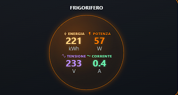
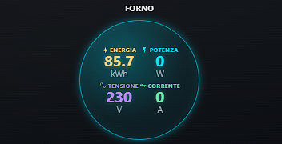
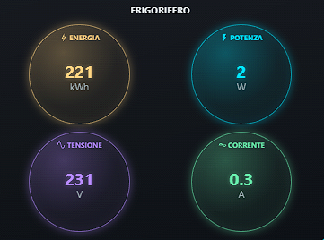
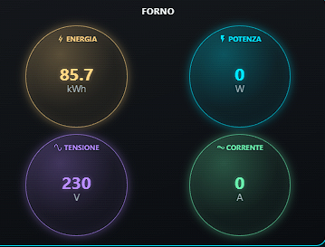

# Power Gauge Panel Card

Scheda Lovelace personalizzata per visualizzare, per una o più stanze, quattro misure: energia, potenza, tensione e corrente. Supporta due impaginazioni (`quad` e `single`), soglie colore globali o per stanza e opzioni di dimensione e spaziatura.

## Esempi

Le immagini mostrano entrambe le modalità: il layout `single` concentra i quattro valori in un cerchio; il layout `quad` mostra un cerchio separato per ciascuna misura.

### Layout single

| Frigorifero | Forno |
|---|---|
|  |  |

### Layout quad

| Frigorifero | Forno |
|---|---|
|  |  |

## Installazione con HACS

Aggiungi questo repository in HACS come **Dashboard**. Dopo averlo scaricato, aggiungi la risorsa JavaScript se Home Assistant non la registra automaticamente:

```text
/hacsfiles/power-gauge-panel-card/power-gauge-panel-card.js
```

Tipo risorsa: **Modulo JavaScript**.

## Esempio

```yaml
type: custom:power-gauge-panel
columns: 3
gap: 16
layout: single
devices:
  - name: Cucina
    power_entity: sensor.cucina_potenza
    energy_entity: sensor.cucina_energia
    voltage_entity: sensor.cucina_tensione
    current_entity: sensor.cucina_corrente
```

Le opzioni supportate sono documentate nei commenti iniziali del file JavaScript. Le entità indicate nell'esempio sono segnaposto: sostituiscile con quelle presenti nel tuo Home Assistant.
